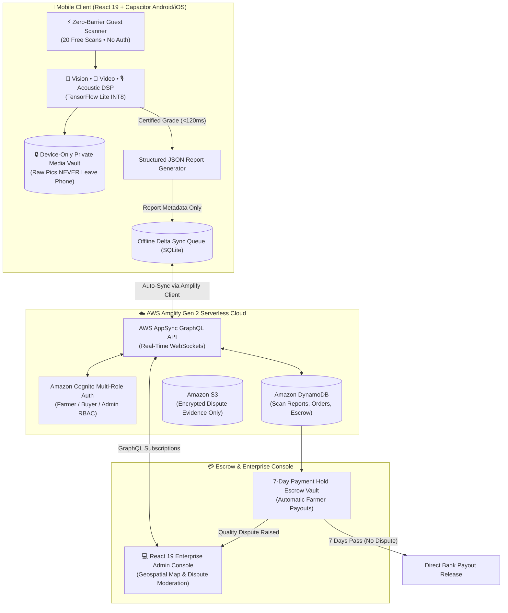

# 🥥 Pooja Coconut Scan AI — Multimodal Edge AI Agricultural Platform

<div align="center">

### **Industrial On-Device Multimodal AI (Vision • Video • Acoustic Audio), 100% Offline Inference, Zero-Barrier Guest Scanning & 7-Day Escrow B2B Marketplace**

[](https://react.dev/)
[](https://capacitorjs.com/)
[](https://www.tensorflow.org/lite)
[](https://aws.amazon.com/amplify/)
[](https://aws.amazon.com/appsync/)
[](https://aws.amazon.com/dynamodb/)
[]()
[]()

<br/>

Architected & Engineered by **[Obaidhur Rahaman](https://rahaman1721.framer.website)** · Full Stack Developer & UI/UX Designer  
*Transforming the multi-billion dollar South Indian coconut supply chain via edge computing, acoustic spectrometry, and unforgeable digital certificates.*

</div>

---

## 📱 Production Deliverables & Live Links

| Artifact | Production Link | Description |
|---|---|---|
| **Android APK** | [⬇️ Download Production Release v1.0.0](https://github.com/rahaman1721/pooja-coconut-scan-ai/releases/tag/v1.0.0) | Complete 24.56 MB signed Android APK package with bundled TFLite delegates and offline DSP pipelines. |
| **Admin Web Console** | [🌐 Live Enterprise Dashboard](https://temporary-rapid-timpani-kicvzzs.vercel.app) | Real-time scan telemetry, user geospatial mapping, quality dispute moderation & market trends. |

---

## 1. Project Title, Badges & Vision

### 🌾 The Vision: Standardizing Agricultural Quality at the Edge
The coconut supply chain across South India (Pollachi, Kangeyam, Thanjavur, Madurai) trades millions of nuts daily across smallholder groves, wholesale mandis, copra drying yards, and commercial oil extraction mills. Historically, the industry suffered from three critical systemic failures:
1. **Subjective Human Grading & Visual Errors:** Manual sorters miss hairline shell micro-fractures and microscopic *Aspergillus niger* fungal spore colonies around the soft germination eye.
2. **Destructive Water & Kernel Guesswork:** Estimating water volume and copra thickness traditionally required destructive cracking of sample nuts or unreliable manual knuckle-tapping.
3. **Severe Payment Risk & Exploitation:** Farmers faced arbitrary post-delivery rejections, delayed payments, and unilateral price deductions after dispatches arrived at destination warehouses.

**Pooja Coconut Scan AI** solves this through a **multimodal on-device edge AI platform**. Operating **100% offline without cellular coverage**, it processes **High-Res Images**, **30fps Continuous Conveyor Video**, and **Acoustic Audio Tapping Resonance** to generate instant cryptographic quality certificates backed by a **7-Day Escrow Payment Hold**.

---

## 2. Exhaustive Module & Feature Breakdown

### 📸 Module A: Multimodal AI Scanning Engine (100% Offline)
- **High-Res Computer Vision (Static Image Mode)**:
  - Custom-trained MobileNetV3-Large INT8 quantized neural network executing via Android NNAPI / GPU delegates.
  - Sub-millimeter shell fracture detection and dehusked mechanical stress damage identification.
  - Surface pathogen segmentation identifying white/black mold (*Aspergillus*, *Fusarium*) around the calyx eye.
  - Automated dimensional classification estimating diameter, circumference, and grade category (Grade A Export, Grade B Domestic, Reject).
  - Adaptive on-device image compression scaling raw 12MP/48MP camera frames down to $<120\text{ KB}$ WebP/JPEG formats, preserving high-frequency edges while conserving local storage.
- **Continuous Conveyor Video Stream (Sorting Bay Mode)**:
  - Real-time 30fps lightweight SSD-MobileNet object tracking designed for wholesale packing facilities and conveyor sorting tables.
  - Automated batch throughput counter (up to 140 nuts/minute) tracking cumulative Grade A, B, and Reject tallies.
  - Visual color-coded bounding boxes with automated audio alert triggers upon reject identification.
- **Acoustic Audio Resonance Spectrometry (Tapping Mode)**:
  - Standardizes traditional knuckle-tapping by capturing 1.5-second acoustic impact audio through the mobile microphone.
  - On-device Fast Fourier Transform (FFT) generating a 128-band Mel-frequency spectrogram.
  - 1D-CNN classifies fundamental resonant pitch ($f_0$) and decay damping constant ($\tau$):
    - **450–600 Hz (High Resonant Ring):** Dense, fully water-filled cavity with high turgor pressure.
    - **$<300\text{ Hz}$ (Dull Low Thud):** Desiccated, empty, or spoiled internal copra without cracking the shell.
- **Multimodal Confidence Fusion**: Combines visual, video, and acoustic probability scores into an aggregate certified quality rating in under 120ms.

### ⚡ Module B: Zero-Barrier Guest Mode & Onboarding
- **Zero-Login Instant Scanning**: Anyone can download the app and immediately scan produce without entering a phone number, email, or waiting for an SMS OTP.
- **20 Free Trial Scans**: Guest devices receive 20 complimentary full multimodal scans stored locally in SQLite.
- **Decoupled Architecture**: Users seeking a pure diagnostic scanner can utilize the application indefinitely without engaging with the commercial marketplace.
- **Hardware Permission Management**: Transparent, context-aware permission requests for Camera2 API, AudioRecord, and Native Storage.

### 🔒 Module C: Privacy-by-Design & Report-Only Cloud Sync
- **Device-Only Sandboxed Media Vault**: Raw camera photographs, video feeds, and microphone audio recordings **NEVER leave the mobile device**.
- **Bandwidth-Conservative Metadata Sync**: Only lightweight JSON audit certificates are synced to AWS DynamoDB:
  - `scanId`, `timestamp`, `compositeGrade`, `defectConfidence`, `acousticResonanceHz`, `waterVolumeEstimate`, `geoHash`, and local SHA-256 image hashes.
- **Dispute-Only Evidence Verification**: Raw compressed images remain isolated locally, uploaded via pre-signed S3 URLs only if a formal buyer dispute is triggered.

### 🛒 Module D: B2B Agricultural Marketplace
- **Seller Batch Publishing**: 1-Click creation of wholesale lots directly from certified scan reports, specifying volume (nut count or metric tonnes), location, and base price.
- **Interactive Price Bargaining & Counter-Offers**: `BuyerBargainPage.jsx` and `SellerNegotiation.jsx` facilitate real-time offer negotiations with counter-proposal limits.
- **Direct Real-Time Messaging**: In-app buyer-seller chat (`BuyerChat.jsx`, `SellerChat.jsx`) for logistics coordination and vehicle dispatch timing.
- **Live Mandi Benchmark Indexing**: Real-time agricultural commodity prices across Pollachi, Kangeyam, Vellore, Thanjavur, and Madurai APMC markets.
- **Golden Seller Certification**: Visual trust verification badges awarded to farms consistently supplying $>95\%$ Grade A lots.

### 💳 Module E: 7-Day Escrow Fintech & Payment Integration
- **Automated 7-Day Escrow Hold Vault**: When a commercial buyer purchases a certified lot, 100% of the funds are locked in secure platform escrow, eliminating farmer payment default risks.
- **7-Day Inspection Buffer**: The buyer receives a mandatory 7-day physical inspection window post-delivery at their drying yard or extraction facility.
- **Automated Direct Bank Payouts**: If no dispute is logged within 7 days, the Escrow Vault triggers an automated settlement directly into the farmer's linked bank account via Razorpay/banking rails.
- **Dispute Lockout & Freeze**: If a quality mismatch or transit damage is reported within 7 days, escrow payouts are immediately frozen, and a formal docket is dispatched to the Vercel Admin Console for arbitration.
- **Digital Gate Pass & Bills of Lading**: Generates PDF/printable gate passes and transit receipts (`PhysicalReceipt.jsx`) complete with batch QR codes and tax breakdowns.

### 💻 Module F: Enterprise Admin Web Console (Live on Vercel)
- **Live Vercel Production Deployment**: Hosted at **[https://temporary-rapid-timpani-kicvzzs.vercel.app](https://temporary-rapid-timpani-kicvzzs.vercel.app)**, sharing the same unified AWS Amplify Gen 2 serverless backend as the mobile client.
- **Executive Telemetry & Revenue Dashboard (`/admin/dashboard`)**:
  - Live metric widgets (`TotalRevenueCard.jsx`, `ImpressionsCard.jsx`, `UserInsightCard.jsx`, `StatCard.jsx`).
  - Real-time gross merchandise value (GMV), active transaction counts, and weekly scan volume telemetry.
- **Master Scan Reports Registry (`/admin/scan-reports`)**:
  - Searchable, filterable ledger (`ScanReportsTable.jsx`) indexing every certified multimodal scan across all mobile users.
  - Granular inspections of AI confidence scores, shell integrity indices, and acoustic resonant frequencies ($f_0$).
- **Chief Inspector Quality Override Engine (`/admin/quality-override`)**:
  - Authorizes certified agricultural officers to review disputed scans, examine evidence, and manually adjust/override automated AI classifications.
- **7-Day Escrow Dispute Mediation Console (`/admin/disputes`)**:
  - Dedicated dispute docket interface reviewing frozen payments, buyer claims, farmer dispatch records, and assigning field arbitrators.
- **Trade Monitor & Order Flow (`/admin/trade-monitor`)**:
  - Real-time audit of B2B transactions (`TradeLogList.jsx`), transit milestones, and digital gate pass validations.
- **Payment & Payout Control Room (`/admin/payments`)**:
  - Oversees active escrow holds, pending settlements, direct bank disbursements, and refund trajectories.
- **Integrated Live Support Desk (`/admin/support`)**:
  - Multi-channel support desk (`SupportDesk.jsx`, `SupportTicketList.jsx`, `SupportChatPanel.jsx`) providing live assistance to farmers and commercial buyers.
- **User Directory & Golden Seller Verification (`/admin/users`)**:
  - Multi-role directory (`UsersTable.jsx`, `UserDetailModal.jsx`) managing role elevations (Farmer, Buyer, Inspector, Admin) and awarding Golden Seller trust badges.
- **Public Play Store Compliance Routes**:
  - Dedicated standalone routes required for Google Play Store & Apple App Store review:
    - `/privacy` (`PublicPrivacyPolicy.jsx`)
    - `/terms` (`PublicTermsOfService.jsx`)
    - `/account-deletion` (`PublicAccountDeletion.jsx` — self-service user data & account deletion).

---

## 3. System Architecture & Tech Stack



| Layer | Technologies & Libraries | Architectural Purpose |
|---|---|---|
| **Mobile Frontend** | React 19, TypeScript, Vite, Tailwind CSS | High-performance mobile client with 60fps view transitions. |
| **Native Runtime** | Capacitor (Android & iOS) | Native Camera2 API, AudioRecord buffer, and local filesystem bridges. |
| **Edge AI Engine** | TensorFlow Lite (INT8 Quantized), Android NNAPI | 100% offline multimodal neural network execution (Vision + Audio). |
| **Cloud Framework** | AWS Amplify Gen 2 | Declarative serverless infrastructure-as-code. |
| **API & Real-Time** | AWS AppSync (GraphQL) | Real-time WebSocket subscriptions and offline delta synchronization. |
| **Database** | Amazon DynamoDB | NoSQL high-throughput storage for scan reports and B2B orders. |
| **Object Storage** | Amazon S3 | Secure evidentiary dispute photography storage via signed URLs. |
| **Auth & Security** | Amazon Cognito User & Identity Pools | JWT-based multi-role separation (Farmer, Buyer, Admin). |
| **Admin Web Console** | React 19, Vercel | Real-time map telemetry, dispute arbitration, and user management. |

---

## 4. Complete Folder Structure

```
pooja-scans-app/
├── amplify/                              # AWS Amplify Gen 2 Backend Infrastructure
│   ├── auth/                             # Amazon Cognito User Pool & Role definitions
│   ├── data/                             # DynamoDB schema & AppSync GraphQL models
│   └── storage/                          # Amazon S3 bucket policies & secure access rules
├── android/                              # Capacitor Android Native Project
│   ├── app/src/main/assets/              # Bundled TFLite models (Vision & Audio CNN)
│   └── app/src/main/java/                # Custom native audio & camera plugins
├── public/                               # Static production assets & PWA manifest
├── src/                                  # React 19 Application Source Code
│   ├── assets/                           # Agricultural iconography, logos, audio test samples
│   ├── components/                       # Modular UI Components
│   │   ├── admin/                        # Dispute review dockets & user approval tables
│   │   ├── buyer/                        # Order cards, filter drawers, bargain modals
│   │   ├── chat/                         # Real-time WebSocket messaging UI
│   │   ├── common/                       # Navigation bars, toasts, loaders, modals
│   │   ├── guest/                        # 20-free-scan counters & zero-login dashboards
│   │   ├── marketplace/                  # B2B product cards & mandi price trackers
│   │   ├── negotiation/                  # Counter-offer sliders & agreement triggers
│   │   ├── payment/                      # 7-day escrow status & payment gateway forms
│   │   └── scan/                         # Camera viewfinder, video HUD & acoustic mic meters
│   ├── context/                          # Global React state (Auth, Toast, NetworkStatus)
│   ├── graphql/                          # Auto-generated GraphQL queries, mutations, subscriptions
│   ├── hooks/                            # Custom React Hooks
│   │   ├── useNetworkStatus.js           # Offline / Online network watcher
│   │   ├── usePermissions.js             # Camera & microphone permission manager
│   │   └── useSafeBack.js                # Hardware back-button exit guard
│   ├── pages/                            # Application View Routes
│   │   ├── buyer/                        # Buyer Home, Marketplace, Tracking, Receipts
│   │   ├── common/                       # GuestDashboard, Permissions, Onboarding
│   │   ├── seller/                       # SellerHome, AddBatch, Orders, Payouts, Earnings
│   │   └── ScanFlow.jsx                  # Unified Multimodal Scanning Interface
│   ├── routes/                           # HashRouter route configuration & auth guards
│   ├── services/                         # Core Business Logic & Native Bridges
│   │   ├── awsService.js                 # AppSync & DynamoDB integration layer
│   │   ├── deviceSessionService.js       # Local guest session & 20-free-scan tracker
│   │   ├── offlineQueueService.js        # SQLite offline transaction sync queue
│   │   └── paymentService.js             # Escrow milestone & Razorpay payment bindings
│   ├── utils/                            # Audio FFT parsers, image compressors, geohashers
│   ├── App.jsx                           # Application root with hardware back-button listener
│   └── main.jsx                          # React 19 DOM bootstrap
├── capacitor.config.json                 # Capacitor app ID, plugins, and splash screen configuration
├── package.json                          # Dependencies & NPM build scripts
└── vite.config.js                        # Vite bundler configuration & PWA worker build
```

---

## 5. Screen / Route & API Inventory

### Major Application Screens & Routes

| Route | Component | Target Role | Primary Purpose |
|---|---|---|---|
| `/guest-dashboard` | `GuestDashboard.jsx` | Guest / Any | **Zero-login home** displaying remaining free scans and quick-scan triggers. |
| `/scan` | `ScanFlow.jsx` | Any | Unified **Image, 30fps Video, and Acoustic Audio** scanning canvas. |
| `/quality-report` | `QualityReport.jsx` | Any | Composite quality rating card with defect breakdowns and local export. |
| `/home` | `buyer/Home.jsx` | Buyer | Authenticated buyer hub with recent market orders and mandi rates. |
| `/market` | `buyer/Marketplace.jsx` | Buyer | Wholesale lot browser with geo-proximity and quality grade filters. |
| `/bargain/:id` | `buyer/BuyerBargainPage.jsx` | Buyer | Real-time price negotiation and counter-offer proposal interface. |
| `/order-tracking` | `buyer/OrderTracking.jsx` | Buyer | Real-time transit milestone viewer with 7-day inspection timer. |
| `/seller/home` | `seller/SellerHome.jsx` | Seller | Farmer dashboard showing active batch listings and incoming bids. |
| `/seller/add-batch` | `seller/SellerAddBatch.jsx` | Seller | 1-Click conversion of an AI scan certificate into a wholesale listing. |
| `/seller/payouts` | `seller/Payouts.jsx` | Seller | 7-day escrow hold status and direct bank account payout ledger. |

### Enterprise Admin Web Console Routes (Vercel Deployed)

| Route | Component | Access Role | Operational Purpose |
|---|---|---|---|
| `/admin/login` | `AdminLogin.jsx` | Super Admin / Inspector | Secure administrative gateway with session expiry guards. |
| `/admin/dashboard` | `AdminDashboard.jsx` | Admin | Real-time GMV, active users, weekly scan charts & revenue metrics. |
| `/admin/scan-reports` | `ScanReportsPage.jsx` | Inspector / Admin | Complete searchable ledger of certified scans with acoustic & visual scores. |
| `/admin/quality-override` | `AdminQualityOverride.jsx` | Chief Inspector | Manual review and override interface for flagged or disputed lots. |
| `/admin/disputes` | `Disputes.jsx` | Arbitrator / Admin | **7-Day Escrow Dispute Mediation** console to review claims and freeze/release funds. |
| `/admin/trade-monitor` | `TradeMonitor.jsx` | Operations | Real-time tracking of active marketplace contracts and digital gate passes. |
| `/admin/payments` | `AdminPayments.jsx` | Finance | Escrow hold monitoring, automated bank disbursements, and refund processing. |
| `/admin/users` | `UserDirectory.jsx` | Admin | User database, role modifications, and Golden Seller badge approvals. |
| `/admin/support` | `SupportDesk.jsx` | Support Team | Live customer support chat and ticket handling for farmers/buyers. |
| `/privacy` | `PublicLegalPages.jsx` | Public | Google Play / App Store mandatory privacy disclosures. |
| `/terms` | `PublicLegalPages.jsx` | Public | B2B marketplace trading terms and escrow conditions. |
| `/account-deletion` | `PublicLegalPages.jsx` | Public | Self-service user account and data deletion compliant with DPDP & GDPR. |

### Core GraphQL Operations & Database Models

```graphql
# Primary Data Models in AWS AppSync / DynamoDB
type ScanReport @model @auth(rules: [{ allow: owner }, { allow: groups, groups: ["Admins"] }]) {
  id: ID!
  farmerId: String!
  compositeGrade: String! # GRADE_A, GRADE_B, REJECT
  shellIntegrityScore: Float!
  fungalRisk: String!
  acousticFrequencyHz: Float!
  waterVolumeEstimate: String!
  geoHash: String!
  localImageHash: String!
  createdAt: AWSDateTime!
}

type MarketplaceListing @model @auth(rules: [{ allow: owner }, { allow: private, operations: [read] }]) {
  id: ID!
  sellerId: String!
  lotVolumeNuts: Int!
  weightMetricTonnes: Float!
  basePricePerNut: Float!
  grade: String!
  locationCity: String!
  escrowStatus: String! # AVAILABLE, LOCKED_IN_ESCROW, SETTLED
}

type OrderEscrow @model @auth(rules: [{ allow: owner }, { allow: groups, groups: ["Admins"] }]) {
  id: ID!
  listingId: String!
  buyerId: String!
  sellerId: String!
  amountINR: Float!
  escrowState: String! # HELD_IN_ESCROW, DISPUTED, RELEASED_TO_FARMER
  inspectionDeadline: AWSDateTime! # 7-day timestamp
}
```

---

## 6. Getting Started (Local Setup & Installation)

### Prerequisites
- **Node.js**: v18.0.0 or higher (v20+ recommended).
- **Package Manager**: `npm` (v9+) or `yarn`.
- **Android Development**: Android Studio Iguana / Jellyfish with Android SDK Platform 34 and Java JDK 17.
- **AWS CLI**: Configured with appropriate Amplify Gen 2 permissions.

### 1. Clone Repository
```bash
git clone https://github.com/rahaman1721/pooja-coconut-scan-ai.git
cd pooja-coconut-scan-ai
```

### 2. Install Dependencies
```bash
npm install
```

### 3. Configure Local Environment
Create a `.env` file in the project root:
```env
VITE_APP_ENV=development
VITE_AWS_REGION=ap-south-1
VITE_ENABLE_MOCK_INFERENCE=false
```

### 4. Run Development Server (Web Sandbox)
```bash
npm run dev
```
Open **[http://localhost:5173](http://localhost:5173)** in your browser.

### 5. Build & Sync with Android
```bash
# Build production web bundle
npm run build

# Sync assets and native plugins to Android container
npx cap sync android

# Open project in Android Studio for APK compilation
npx cap open android
```

---

<div align="center">
  <sub>Pioneering multimodal edge AI for agricultural empowerment · Designed & Built by <a href="https://rahaman1721.framer.website">Obaidhur Rahaman</a> © 2026</sub>
</div>
