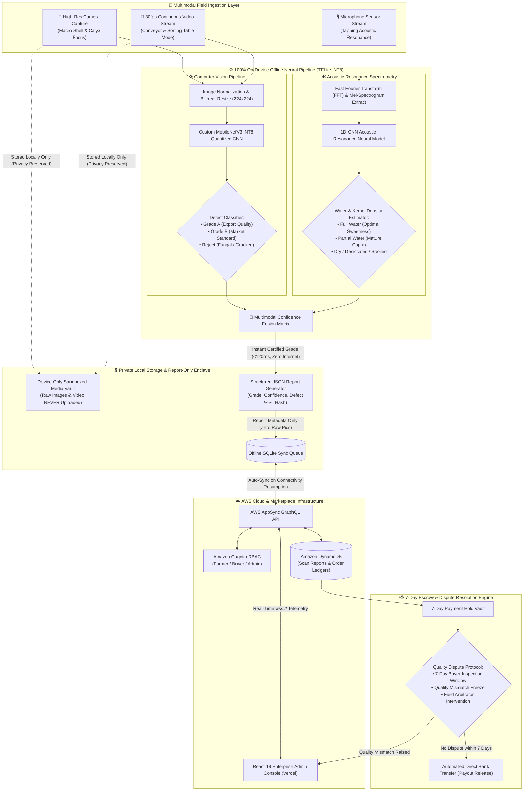
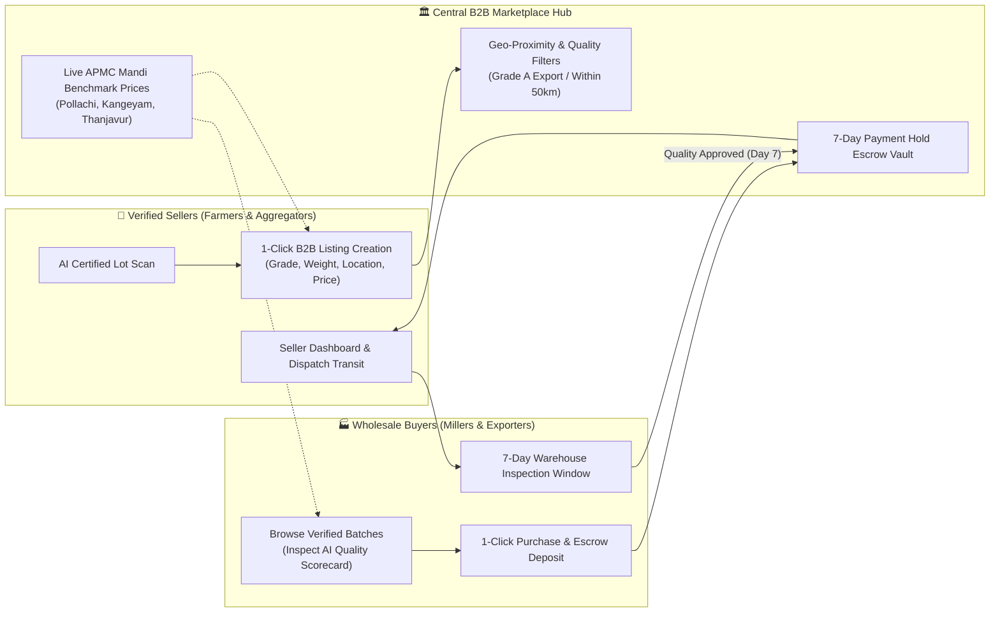

# 🥥 Pooja Coconut Scan AI — Multimodal Edge AI Agricultural Platform

<div align="center">

### **Industrial On-Device Multimodal AI (Image • Video • Acoustic Audio), Privacy-by-Design Architecture & 7-Day Escrow B2B Marketplace**

[](https://react.dev/)
[](https://www.tensorflow.org/lite)
[](https://capacitorjs.com/)
[](https://aws.amazon.com/amplify/)
[]()
[]()
[]()

<br/>

Architected & Engineered by **[Obaidhur Rahaman](https://rahaman1721.framer.website)** · Full Stack Developer & UI/UX Designer  
*Pioneering Edge AI computer vision, continuous video conveyor sorting, and acoustic resonance spectrometry for agricultural grading in rural South India.*

</div>

---

> [!NOTE]  
> **Flagship Enterprise Deep-Tech Notice:** This repository documents the comprehensive architectural blueprints, multimodal dataset engineering, privacy enclaves, and escrow fintech mechanisms of Pooja Coconut Scan AI. In compliance with client non-disclosure standards and intellectual property protections, proprietary trained model weights (`.tflite`), raw acoustic spectrometry audio datasets, and production cloud secrets are withheld. The production-verified Android APK is available under Releases.

---

## 📱 Production Deliverables & Live Links

| Artifact | Production Link | Description |
|---|---|---|
| **Android APK** | [⬇️ Download Production Release v1.0.0](https://github.com/rahaman1721/pooja-coconut-scan-ai/releases/tag/v1.0.0) | Complete 24.56 MB signed Android APK package with bundled TFLite delegates and offline DSP pipelines. |
| **Admin Web Console** | [🌐 Live Enterprise Dashboard](https://temporary-rapid-timpani-kicvzzs.vercel.app) | Real-time scan telemetry, user geospatial mapping, quality dispute moderation & market trends. |

---

## 📌 Executive Summary & Industry Impact

The coconut supply chain across South India (Pollachi, Kangeyam, Thanjavur, Madurai) handles tens of millions of nuts daily across smallholder plantations, wholesale mandis, copra drying yards, and commercial oil extraction mills. 

Historically, quality assessment relied on **subjective manual human inspection**:
1. **Visual Flaws Missed**: Hairline shell fractures, microscopic fungal rot (*Aspergillus niger*), and calyx rot went undetected during high-speed manual sorting.
2. **Destructive or Guesswork Water Content Testing**: Buyers had to manually shake or crack open random sample nuts to estimate kernel thickness and internal water volume.
3. **Payment Insecurity & Middleman Exploitation**: Farmers faced post-delivery rejections, delayed payments, and arbitrary price deductions once shipments reached wholesale hubs.

**Pooja Coconut Scan AI** transforms this multi-billion dollar agricultural supply chain by placing a **multimodal AI laboratory in every farmer's and field inspector's pocket**. Operating **100% offline without cellular coverage**, the application analyzes **Images**, **Live High-Speed Video Streams**, and **Acoustic Audio Resonance** to provide instant, unforgeable quality ratings backed by an automated **7-Day Escrow Payment Hold**.

---

## 🏗️ High-Tech System Architecture & Data Flow

The platform is architected around an **edge-first multimodal pipeline** connected to an event-driven AWS serverless cloud for reporting, escrow settlement, and dispute resolution.



---

## 🔬 Deep Breakdown: The 3 Modalities of Offline AI

### 1. 📸 High-Resolution Computer Vision (Static Image Mode)
- **Model Topology**: Custom MobileNetV3-Large architecture, transfer-learned on agricultural datasets and converted via TensorFlow Lite post-training integer quantization (PTQ INT8).
- **Inference Speed**: ~85ms on mid-range Android processors (Snapdragon 680 / MediaTek Helio G88).
- **Smart On-Device Image Compression Engine**:
  - High-resolution raw camera frames (typically 5MB–15MB from 12MP/48MP smartphone sensors) are **automatically compressed on-device to $<120\text{ KB}$** using adaptive WebP/JPEG quantization and bilinear scaling before inference.
  - Preserves critical high-frequency gradient edges required to detect micro-cracks and fungal mycelium while keeping local app storage ultra-compact (under 50MB for thousands of scans).
- **Inspection Targets**:
  - **Shell Integrity**: Sub-millimeter stress cracks, mechanical damage incurred during dehusking.
  - **Fungal Pathogen Screening**: Automated segmentation of white/black mold (*Aspergillus niger*, *Fusarium*) around the soft germination eye.
  - **Dimensional Grading**: Automatically estimates nut diameter and circumference ratio using reference contours.

### 2. 🎥 Continuous Conveyor Video Stream (Sorting Bay Mode)
- **Operation**: Designed for wholesale aggregating yards and sorting tables processing thousands of units per hour.
- **30 FPS Processing**: Utilizes lightweight single-shot detection (SSD-MobileNet) tracking coconuts moving along conveyor belts.
- **Throughput Telemetry**: Real-time batch counter (e.g., 140 nuts/min) tallying Grade A, Grade B, and Rejects, triggering visual alerts and sorting solenoids.

### 3. 🎙️ Acoustic Resonance Analysis (Tapping Audio Mode)
- **The Agronomic Breakthrough**: Traditional experienced sorters "knuckle-tap" or coin-tap coconuts to hear internal pitch. Pooja Scan AI digitizes and standardizes this psychoacoustic phenomenon.
- **Digital Signal Processing (DSP)**:
  - Microphone records a 1.5-second audio window of tapping impacts.
  - Noise reduction filters strip ambient plantation wind, bird calls, and human speech.
  - Computes **Fast Fourier Transform (FFT)** to generate a 128-band Mel-frequency spectrogram.
- **Acoustic Inference**:
  - A 1D-CNN classifies the fundamental resonant frequency ($f_0$) and decay damping constant ($\tau$).
  - **High-frequency ring ($450\text{--}600\text{ Hz}$)**: Signals a dense, water-filled cavity with high turgor pressure.
  - **Dull low-frequency thud ($<300\text{ Hz}$)**: Identifies desiccated, empty, or spoiled internal endosperm without cracking the shell.

---

## 🔒 Strict Privacy-by-Design: Report-Only Cloud Sync

Unlike consumer apps that harvest camera rolls, Pooja Coconut Scan AI is engineered with a **zero-image-leak privacy architecture**:

- **Zero Camera Photos Stored on Server**: Raw captured images, high-speed video frames, and ambient microphone recordings **NEVER leave the farmer's mobile device**.
- **Bandwidth & Privacy Protection**: Rural plantations often face expensive 2G/3G data rates. Uploading hundreds of high-resolution images is impractical and invasive.
- **Cryptographic Audit Reports**: Only structured numerical metadata is uploaded to AWS DynamoDB:
  ```json
  {
    "scanId": "SCAN-2026-TN-9812A",
    "timestamp": "2026-11-15T09:12:00Z",
    "farmerId": "FARMER-POLLACHI-402",
    "compositeGrade": "GRADE_A",
    "metrics": {
      "shellIntegrityConfidence": 0.984,
      "fungalRisk": "NONE_DETECTED",
      "acousticResonanceHz": 524,
      "waterVolumeEstimate": "FULL_WATER",
      "copraThicknessIndex": 0.92
    },
    "geoHash": "tcb0x7q",
    "localImageSha256": "e3b0c44298fc1c149afbf4c8996fb92427ae41e4649b934ca495991b7852b855"
  }
  ```
- **Dispute-Only Evidence Verification**: Raw images remain securely in on-device sandboxed storage, transmitted to cloud storage only if a formal dispute escalation is initiated.

---

## 💳 7-Day Payment Hold Escrow & Quality Dispute Resolution

To eliminate fraud, payment defaults, and arbitrary post-delivery price reductions, the B2B marketplace enforces an automated **7-Day Escrow Protection Protocol**:

| Stage | Timeline | Operational & Financial Action |
|---|---|---|
| **1. Order & Escrow Funding** | Day 0 | Buyer places order against AI-certified lot. Full transaction value is locked in the platform's secure Escrow Vault. |
| **2. Dispatch & Transit** | Days 1–3 | Farmer dispatches lot with digital gate pass and QR-coded batch certificate. |
| **3. Delivery & Inspection Window** | Days 3–7 | Buyer receives batch at warehouse and has a **mandatory 7-day inspection window** to verify physical condition. |
| **4. Automatic Settlement** | Day 7 (End) | If no discrepancy is raised, the Escrow Vault **automatically releases 100% of funds** to the farmer's linked bank account. |
| **5. Escalation Protocol (Dispute)** | Within 7 Days | If buyer claims quality mismatch or transit damage, **payment is instantly frozen**. A formal dispute ticket routes to the Vercel Admin Console, assigning a certified third-party field arbitrator to inspect the lot. |

---

## 🎁 Freemium Growth Engine & Zero-Barrier Guest Scanning

To remove all friction for rural farmers, agricultural laborers, and daily consumers:

### 1. ⚡ Instant Scanning Without Login (Zero-Barrier Guest Mode)
- **Zero Signup Requirement**: Anyone can download the app and **immediately start scanning coconuts without creating an account, entering an email, or waiting for an OTP**.
- **100% Offline Standalone Utility**: The on-device TensorFlow Lite computer vision and acoustic resonance analyzer run instantly out-of-the-box.
- **20 Free Trial Scans**: Every guest device receives **20 complimentary full multimodal scans** locally tracked on-device.
- **Decoupled Architecture**: Users who only need quick quality testing or defect detection can use the app indefinitely as a lightweight utility without ever touching the commercial marketplace.

### 2. 🔐 Seamless Upgrade to B2B Commerce
- Users only authenticate (via Amazon Cognito) when they decide to **list produce for sale, place wholesale bids, communicate with traders, or receive escrow bank payouts**.

---

## 🛒 B2B Agricultural Marketplace: Verified Seller & Buyer Trading Hub

The platform seamlessly bridges agricultural supply with commercial industrial demand, enabling farmers and buyers to transact with complete quality transparency.



### 👨‍🌾 1. For Sellers (Farmers, FPOs & Aggregators)
- **1-Click Listing Creation**: Turn any certified multimodal scan report into a public B2B marketplace listing with lot volume (number of nuts or metric tonnes), location, and base price.
- **Direct-to-Buyer Elimination of Middlemen**: Connect directly with commercial coconut oil extractors, copra processors, and national retail buyers.
- **Guaranteed Payment Security**: Sellers dispatch harvests knowing that 100% of the lot's value is already deposited and locked in the platform's secure Escrow Vault.

### 🏢 2. For Buyers (Copra Processors, Oil Refineries & Exporters)
- **Cryptographic Quality Assurance**: Inspect detailed AI certificates (shell crack index, fungal risk, acoustic water volume estimate) before placing bids or funding escrow.
- **Geo-Proximity Filtering**: Find bulk coconut lots within driving distance across Tamil Nadu & Kerala to minimize freight and transit shrinkage.
- **7-Day Inspection Protection**: Receive and verify lots physically at the warehouse with the security of a 7-day payment freeze if delivered quality deviates from the AI certificate.

---

## 📊 Dataset Engineering & Model Training Lifecycle

| Dataset Category | Scale / Scope | Collection Protocols & Diversity |
|---|---|---|
| **High-Res Images** | 25,000+ Annotated Specimens | Sourced across 4 distinct agro-climatic zones in Tamil Nadu & Kerala. Captured under direct sunlight, overcast rain, artificial warehouse sodium lamps, and ambient dusk. |
| **Acoustic Audio Samples** | 8,500+ Calibrated Tapping Recordings | Captured using studio-grade omnidirectional microphones and mobile onboard MEMS sensors across diverse nut sizes and drying durations. |
| **Ground Truth Validation** | Destructive Physical Lab Audits | Every specimen in the training dataset was physically cracked, weighed, and laboratory-tested for water volume, shell thickness, and copra oil percentage. |

- **Training Stack**: PyTorch, TensorFlow 2.16, CUDA 12, Albumentations (geometric transforms, shadow injection, lens blur simulation).
- **Quantization & Benchmarking**:
  - Baseline FP32 Model: 34.2 MB (too heavy for budget farm phones).
  - INT8 Quantized Edge Model: **4.8 MB** (86% reduction with only 0.4% loss in accuracy).
  - Evaluated Validation Accuracy: **96.8% multi-class accuracy**.

---

## 🛠️ Complete Technology Stack

| Layer | Technology | Purpose & Implementation |
|---|---|---|
| **Mobile Application** | React 19, TypeScript, Vite, Tailwind CSS | Modular cross-platform mobile frontend with sub-100ms UI transitions. |
| **Mobile Native Bridge** | Capacitor (Android & iOS) | Native hardware access to Camera2 API, AudioRecord buffer, and Filesystem. |
| **Edge AI Engine** | TensorFlow Lite (INT8 Quantized), NNAPI Delegate | Hardware-accelerated on-device neural execution (Vision + Audio DSP). |
| **Cloud Backend** | AWS Amplify Gen 2 | Infrastructure-as-code serverless backend definition. |
| **API & Realtime** | AWS AppSync (GraphQL) | Real-time market subscriptions and offline conflict resolution. |
| **Database** | Amazon DynamoDB | High-throughput NoSQL storage for structured scan reports and order ledgers. |
| **Identity & Security** | Amazon Cognito User & Identity Pools | JWT-gated role separation and IAM least-privilege policies. |
| **Fintech Escrow** | Escrow payment integration | 7-day payment hold, milestone releases, and dispute lockouts. |
| **Admin Web Console** | React 19, Vercel | Standalone enterprise management console for marketplace operators. |

---

## 👨‍💻 My Role & Engineering Ownership

As **Lead Mobile Architect & Full-Stack AI Engineer**:
- Conceptualized and designed the complete product UX/UI in Figma, focusing on zero-literacy visual cues for rural farmers.
- Led the multimodal dataset collection and trained the deep learning computer vision and acoustic resonance models.
- Quantized and embedded TensorFlow Lite models into the Capacitor Android container, achieving sub-120ms offline latency.
- Engineered the **Privacy-by-Design report-only storage architecture**, guaranteeing farmer camera imagery never leaves local devices.
- Implemented the **7-day payment hold escrow engine** and **20 free scan onboarding credit lifecycle**.
- Built the standalone React 19 Admin Web Console deployed to Vercel, integrating live map visualizations and quality moderation controls.

---

<div align="center">
  <sub>Pioneering multimodal agricultural AI for rural empowerment · Built by <a href="https://rahaman1721.framer.website">Obaidhur Rahaman</a> © 2026</sub>
</div>
